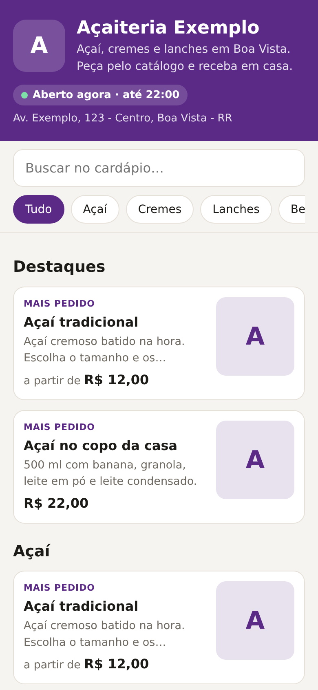
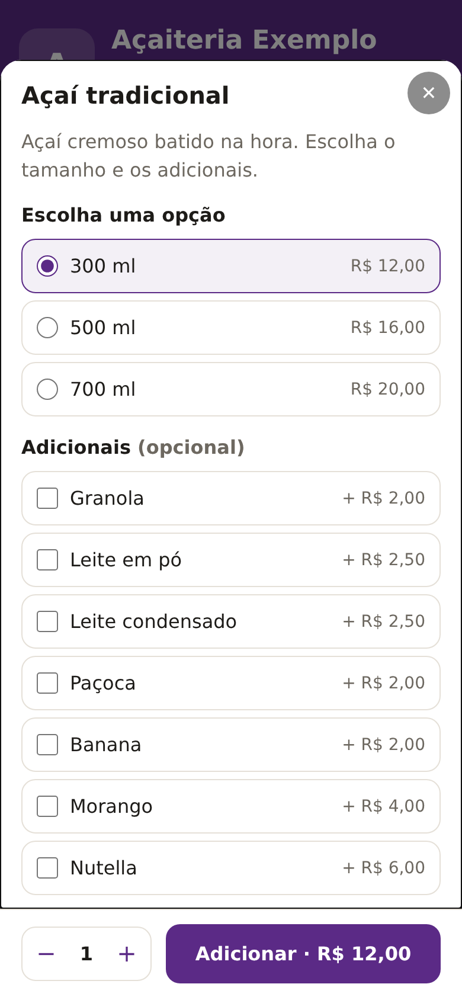

# Catálogo com pedido pelo WhatsApp

Cardápio ou catálogo online para **comércio local**: o cliente monta o pedido no site e o pedido chega **pronto no WhatsApp da loja**, com itens, tamanhos, adicionais, taxa de entrega do bairro, forma de pagamento e endereço.

- **O dono atualiza tudo numa planilha do Google**, pelo celular: preço, produto novo, "acabou o morango". O site muda sozinho.
- **Sem comissão por pedido, sem app para instalar e sem servidor.** É um site estático, que fica de graça no GitHub Pages ou em qualquer hospedagem.
- Funciona para **açaiteria, lanchonete, pizzaria, padaria, salgados, confeitaria, mercadinho, loja de roupas, distribuidora…**

<p align="center">
  
  
</p>

---

## Como funciona

### Para o cliente

1. Abre o link do catálogo, que pode estar no Instagram, no Google Maps, num QR Code na mesa ou num adesivo.
2. Vê se a loja está **aberta agora** e até que horas, busca ou navega pelas categorias.
3. Toca no produto, escolhe **tamanho**, **adicionais** e quantidade, e escreve uma observação se quiser ("pouco gelo").
4. Toca em **"Ver pedido"**, escolhe **entrega** (pelo bairro, com a taxa já calculada) ou **retirada**, a **forma de pagamento** (troco, ou a chave Pix com botão de copiar) e o nome.
5. Toca em **"Enviar pedido pelo WhatsApp"**. O WhatsApp abre com a mensagem pronta, e é só enviar:

```
*Pedido · Açaiteria Exemplo*

2x Açaí tradicional (500 ml) — R$ 36,00
   + Granola
   obs.: pouco gelo
1x Água mineral — R$ 3,50

Subtotal: R$ 39,50
Entrega (Caçari): R$ 6,00
*Total: R$ 45,50*

Nome: Maria
Entregar em: Rua A, 10 - Caçari
Referência: portão azul
Pagamento: Dinheiro (troco para R$ 50,00)
```

O site lembra os dados do cliente (nome, endereço, bairro) para o próximo pedido, e guarda o carrinho se ele fechar a página no meio.

### Para a loja

- O pedido chega **organizado**: sem "quanto é?", sem "qual o endereço?", sem conta errada.
- **Pedido mínimo**, **taxa por bairro** e **horário de funcionamento** já vêm resolvidos. Fora do horário, o cliente é avisado de que o pedido será respondido quando a loja abrir.
- Produto esgotado: coloca **"não"** na coluna `disponivel` da planilha, e ele aparece apagado, sem poder pedir.
- Tudo continua no WhatsApp, onde a loja já atende. Não muda nada na rotina.

---

## A planilha de produtos

Uma linha por produto. A primeira linha é o cabeçalho:

| categoria | nome | descricao | preco | variacoes | adicionais | imagem | disponivel | destaque |
|---|---|---|---|---|---|---|---|---|
| Açaí | Açaí tradicional | Batido na hora. | | 300 ml=12,00 \| 500 ml=16,00 | Granola=2,00 \| Nutella=6,00 | | sim | sim |
| Bebidas | Refrigerante lata | 350 ml. | 6,00 | Coca-Cola \| Guaraná | | | sim | |
| Cremes | Creme de buriti | Sabor de Roraima. | 14,00 | | | | não | |

- **preco:** pode escrever `12,50`, `R$ 12,50` ou `12.50`.
- **variacoes:** o cliente escolhe **uma**, como tamanho, sabor ou cor. Separe com `|`. Com `=preço`, a variação tem preço próprio (e o card mostra "a partir de"); sem preço, vale o da coluna `preco`, como os sabores do refrigerante.
- **adicionais:** o cliente escolhe **quantos quiser**, cada um somando o seu preço.
- **imagem:** link de uma foto. Sem foto, aparece a inicial do produto na cor da loja.
- **disponivel:** vazio ou `sim` = à venda; `não` = esgotado.
- **destaque:** `sim` coloca o produto em "Destaques", no topo, com o selo "Mais pedido".

### Usando o Google Planilhas (recomendado para o cliente)

1. Crie a planilha com essas colunas, ou importe o [`data/produtos.csv`](data/produtos.csv).
2. **Arquivo → Compartilhar → Publicar na Web** → escolha a aba → formato **Valores separados por vírgula (.csv)** → **Publicar**.
3. Copie o link gerado e coloque em `"produtos"` no `data/loja.json`.

Pronto: toda alteração na planilha aparece no site em alguns minutos (o Google atualiza a versão publicada sozinho). Quem só edita a planilha **não precisa mexer no site**.

## Configuração da loja (`data/loja.json`)

```json
{
  "nome": "Açaiteria Exemplo",
  "descricao": "Açaí, cremes e lanches em Boa Vista.",
  "whatsapp": "95999999999",
  "cor": "#5b2a86",
  "logo": "img/logo.png",
  "endereco": "Av. Exemplo, 123 - Centro, Boa Vista - RR",
  "instagram": "@acaiteriaexemplo",
  "produtos": "data/produtos.csv",
  "pedido_minimo": 15,
  "horarios": { "seg": "14:00-22:00", "sab": "10:00-12:00, 14:00-23:30", "dom": "fechado" },
  "entrega": {
    "retirada": true,
    "bairros": [{ "nome": "Centro", "taxa": 4 }, { "nome": "Caçari", "taxa": 6 }],
    "aviso_outros_bairros": "Seu bairro não está na lista? Escolha \"Outro bairro\"."
  },
  "pagamento": ["Pix", "Cartão (maquininha na entrega)", "Dinheiro"],
  "pix": "chave-pix-da-loja"
}
```

| Campo | Para quê |
|---|---|
| `whatsapp` | número que recebe os pedidos (DDD + número; o `55` é colocado sozinho) |
| `cor` | cor da marca: topo, botões e destaques. O texto fica branco ou preto conforme a cor, para dar leitura. |
| `logo` | imagem quadrada. Sem logo, aparece a inicial do nome. |
| `horarios` | por dia (`seg` … `dom`). Aceita duas faixas (`"08:00-12:00, 14:00-18:00"`), horário que passa da meia-noite (`"18:00-02:00"`) e `"fechado"`. Sem `horarios`, a loja aparece sempre aberta. |
| `entrega.bairros` | taxa de cada bairro (`0` = grátis). Bairro fora da lista: "taxa a combinar" no WhatsApp. |
| `entrega.retirada` | `true` mostra a opção "Retirar na loja". |
| `pedido_minimo` | abaixo disso, o botão de enviar fica bloqueado e mostra quanto falta. |
| `pagamento` | formas aceitas. `Dinheiro` pergunta o troco; `Pix` mostra a chave com botão de copiar. |

**Link direto para um produto:** `seusite/#p=acai-tradicional` abre o catálogo já com o produto. É bom para postar no Instagram.

---

## Publicar

É só HTML, CSS e JavaScript, sem instalação nem build.

- **GitHub Pages:** suba a pasta num repositório → **Settings → Pages → Deploy from a branch → main**. O site fica em `https://usuario.github.io/repositorio/`.
- **Domínio próprio:** `cardapio.nomedaloja.com.br` aponta para o GitHub Pages ou para qualquer hospedagem.
- **Para testar no computador:** `python -m http.server` na pasta e abra `http://localhost:8000`. Abrir o `index.html` direto pelo arquivo não funciona, porque o navegador bloqueia a leitura da planilha.

Para cada loja nova, copie a pasta, troque o `loja.json`, a planilha e o logo.

## Estrutura

```
catalogo-whatsapp/
├── index.html          # página única
├── css/catalogo.css    # visual (pensado primeiro para o celular)
├── js/nucleo.js        # regras: planilha, preços, carrinho, horário, mensagem
├── js/app.js           # tela: catálogo, janelas, carrinho e envio
├── data/loja.json      # dados da loja
├── data/produtos.csv   # produtos de exemplo
└── tests/              # testes das regras (Node)
```

## Testes

```bash
docker run --rm -v "${PWD}:/app" -w /app node:22-slim node --test tests/nucleo.test.mjs
```

10 testes cobrem:
- a leitura da planilha (`;` ou `,`, aspas, quebra de linha, exportação do Google);
- os preços como as pessoas digitam;
- variações com e sem preço próprio, e os adicionais;
- o carrinho (junta itens iguais, separa os diferentes);
- a taxa por bairro, o bairro fora da lista e o pedido mínimo;
- a **mensagem exata** que vai para o WhatsApp;
- o link do WhatsApp;
- o horário de funcionamento (duas faixas, madrugada, "abre amanhã", "abre segunda").

---

Feito por **Ítalo Fonteles** · [italofonteles.dev](https://italofonteles.dev) · contato@italofonteles.dev
